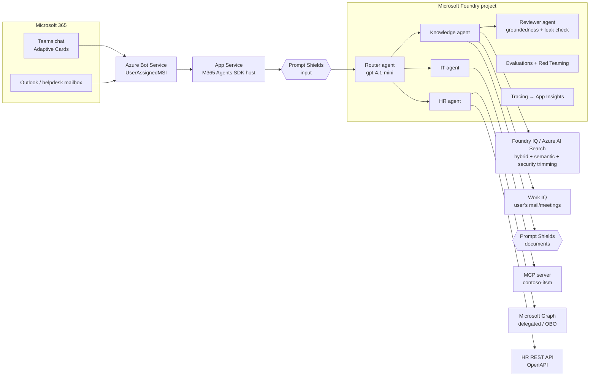

# Architecture

## Request flow
1. **Channel** – Teams/Outlook activity arrives at `/api/messages`; Bot Service authenticates with the
   bot's user-assigned managed identity. The user's identity comes from the activity + Teams SSO token.
2. **Input shield** – Prompt Shields (+ local heuristics) screen the message. Attacks are refused and logged.
3. **Router** – a small model classifies intent into `knowledge | it | hr` (JSON mode, falls back to knowledge).
4. **Specialist**
   - *Knowledge*: retrieves from Azure AI Search / Foundry IQ filtered by the user's groups, screens each
     document with Prompt Shields (indirect injection), spotlights the survivors, answers with citations.
   - *IT*: tool calling against the MCP ticketing server. `create_ticket` is side-effecting → returns an
     **approval card**; it runs only after `Action.Execute` → `approveAction`.
   - *HR*: Graph (manager, calendar) and HR API (leave) **as the user** via on-behalf-of.
5. **Reviewer** – checks the knowledge answer is supported by its sources and leaks nothing sensitive.
6. **Response** – rendered as an Adaptive Card (answer, sources, feedback buttons). Feedback is logged
   as an eval signal.

## Two runtimes, one design
| | `orchestrator.py` | `agent_framework_runtime.py` |
|---|---|---|
| Purpose | reference pipeline, deterministic, used by tests/evals | production agents on Microsoft Agent Framework + Foundry |
| Orchestration | explicit router → specialist → reviewer | orchestrator agent with specialists exposed via `Agent.as_tool()` |
| Tools | `Tool` + allow-list | `@tool`, `MCPStreamableHTTPTool(allowed_tools=…, approval_mode=…)` |

## Key design decisions
- **Keyless everywhere.** `disableLocalAuth` on AI Services, Search and Bot; Managed Identity + RBAC only.
- **Delegated data access.** Graph/Search/Work IQ use the user's token, so the agent can never see more
  than the user. App-only Graph permissions are not granted.
- **Human-in-the-loop for side effects.** Any tool flagged `side_effect=True` (or `always_require_approval`
  in Agent Framework) needs an explicit click. Card payloads are re-authorized server-side.
- **Defence in depth against injection.** Prompt Shields → spotlighting → instruction hierarchy in prompts →
  tool allow-lists → reviewer → approval gate. Any one layer failing doesn't give an attacker a tool.
- **Cheap router, strong specialists.** gpt-4.1-mini for routing, gpt-4.1 for answering.
